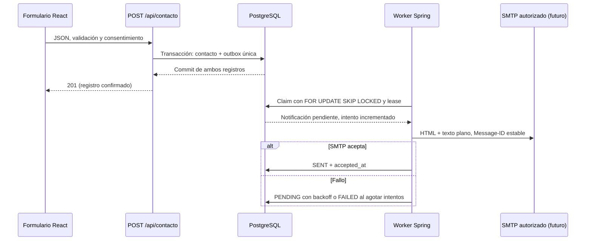

# CerTech — Mejoras web Fase 2: notificaciones de contacto

## Dictamen y alcance

**APROBADO CON OBSERVACIONES para uso y revisión local. Envío real DESACTIVADO.**
Sin commits, push, merge, despliegue, cambios en main ni recursos contratados.
Trabajo preparado en copia aislada, conservando la rama original
`security/phase-1-hardening`, las Fases de seguridad 1/2/4 y el botón WhatsApp.
No se modifica React, CORS, límites HTTP ni el contrato público del formulario.
No se han probado credenciales, certificados o entregabilidad de ningún proveedor real.

## Arquitectura implementada



- `SolicitudContactoService.crear` conserva su transacción JPA. El contacto se
  persiste y su ID se inserta en outbox usando el mismo DataSource/transacción.
  `enqueue` exige una transacción existente (MANDATORY).
- Si falla la inserción en outbox, también se revierte el contacto y no hay 201.
  Si falla SMTP posteriormente, el contacto ya confirmado permanece guardado.
- V3 crea `contact_notification_outbox`, FK con borrado en cascada y restricción
  UNIQUE por contacto. No duplica el contenido personal: el worker lo consulta
  del contacto al reclamar el trabajo. La dirección destino se fija en la fila
  al crear la solicitud; cambiar la configuración no redirige el backlog previo.
- La outbox se crea **aunque el envío esté desactivado**. No se crean trabajos
  retroactivos para contactos anteriores a V3. Revisar propósito, destinatario,
  consentimiento, antigüedad y retención antes de activar el backlog.
- Health de correo se desactiva explícitamente: el proveedor SMTP no decide la
  disponibilidad del registro de contactos. La salud de la cola se monitoriza
  por separado. El endpoint health sin SMTP está cubierto por regresión.
- Worker habilitado solo con `CONTACT_NOTIFICATIONS_ENABLED=true`. No añade API
  administrativa ni llamadas SMTP en el hilo HTTP. Procesa lotes acotados.
- Claim en transacción corta e independiente; envío fuera de ella; lease/token
  único protegen contra propietarios obsoletos. Cada claim incrementa el intento
  antes de llamar al proveedor. Un trabajo interrumpido se recupera al vencer el
  lease. Un último intento interrumpido termina FAILED tras vencer ese lease.
- Espera exponencial de 60, 120, 240 y 480 segundos por defecto (máximo 5 intentos,
  tope configurable de 3600 s por espera), más el intervalo de polling. FAILED no
  se reintenta automáticamente; requiere revisión del operador.
- `SENT` significa **aceptado por SMTP**, no entregado a la bandeja del destinatario.
  El frontend sigue confirmando solamente el registro de la solicitud.

### Duplicados: garantía y límite real

UNIQUE(contact_id), estado terminal, SKIP LOCKED, lease y token evitan trabajos
repetidos y envíos concurrentes ordinarios. `Message-ID` conserva el UUID de la
notificación entre intentos, incluso después de reiniciar. Un nuevo POST crea
otra solicitud: esta fase no implementa idempotencia entre solicitudes HTTP.

**SMTP no ofrece exactly-once ni clave de idempotencia contractual.** Si acepta
el mensaje y se pierde el ACK o el proceso cae antes de actualizar PostgreSQL,
el reintento podría entregar un duplicado. Los servidores no están obligados a
deduplicar por Message-ID. Un envío excepcionalmente lento que exceda el lease
puede producir el mismo riesgo. Mantener el lease holgadamente superior a los
timeouts; el guard rechaza configuraciones evidentemente incompatibles.

## Plantilla y seguridad

Asunto fijo: **Nueva solicitud recibida — CerTech**.

HTML UTF-8 con encabezado CerTech, tabla de detalles, estilos autocontenidos y
sin imágenes, scripts, enlaces suministrados por el visitante ni rastreadores.
Alternativa `text/plain` en `multipart/alternative`.

Incluye nombre, correo, empresa, servicio, presupuesto, descripción y fecha de
recepción; omite opcionales vacíos. Fecha transformada a `America/Bogota` con
nombre de zona y desplazamiento UTC, por ejemplo
`2026-10-21 12:30:00 -05:00 [America/Bogota]`.

Todos los valores HTML escapan `& < > " '`. Los datos personales solo aparecen
en el contenido solicitado. From, To y Subject no provienen del visitante.
Reply-To se añade únicamente si Jakarta Mail valida una sola dirección sin
CR/LF, grupos ni nombre de presentación. Validar sintaxis no verifica propiedad
del buzón: evitar responder automáticamente con información sensible.

Los logs del worker muestran UUID/intento o indisponibilidad genérica; no
incluyen excepciones SMTP, mensajes, direcciones, credenciales ni cuerpos. La
outbox solo guarda códigos de error controlados. No habilitar debug de JavaMail
ni logging SQL con parámetros. No hay secretos SMTP ni cambios en `VITE_*`.

## Configuración (solo backend)

`.env.example` documenta valores vacíos de credenciales. Spring Boot lee el
entorno del proceso; **no carga automáticamente `.env`**. Inyectar variables en
el proceso local/hosting autorizado, sin subir `.env` al repositorio.

| Variable | Predeterminado / finalidad |
|---|---|
| CONTACT_NOTIFICATIONS_ENABLED | false; autorizar explícitamente antes de true |
| CONTACT_NOTIFICATIONS_TO | prodbydsceron@gmail.com; un solo buzón |
| CONTACT_NOTIFICATIONS_FROM | vacío; remitente previamente autorizado por proveedor |
| CONTACT_NOTIFICATIONS_ZONE | America/Bogota |
| SMTP_HOST | 127.0.0.1; servidor real solo tras autorización |
| SMTP_PORT | 587; protocolo SMTP con STARTTLS obligatorio |
| SMTP_USERNAME / SMTP_PASSWORD | vacíos; credencial exclusiva del backend |
| SMTP_CONNECTION_TIMEOUT_MS | 5000 |
| SMTP_READ_TIMEOUT_MS | 5000 |
| SMTP_WRITE_TIMEOUT_MS | 5000 |
| CONTACT_NOTIFICATIONS_MAX_ATTEMPTS | 5; rango 1–10 |
| CONTACT_NOTIFICATIONS_RETRY_SECONDS | 60; espera inicial |
| CONTACT_NOTIFICATIONS_MAX_RETRY_SECONDS | 3600; máximo 86400 |
| CONTACT_NOTIFICATIONS_LEASE_SECONDS | 300; rango 60–3600 |
| CONTACT_NOTIFICATIONS_BATCH_SIZE | 1; rango 1–20 |
| CONTACT_NOTIFICATIONS_POLL_MS | 60000; mínimo 1000, máximo 86400000 |

`SmtpTransportGuard` requiere credenciales no vacías, SMTP, autenticación,
STARTTLS obligatorio, verificación de hostname, timeouts positivos de hasta
30000 ms, debug desactivado y lease suficiente. Configuración incorrecta con
notificaciones activas bloquea el arranque, evitando degradación silenciosa.
Solo se implementa SMTP/STARTTLS: no configurar SMTPS implícito en puerto 465.

### Activación futura, no ejecutada

1. Autorizar por separado el proveedor, el envío real y el tratamiento de datos
   por correo. Elegir una cuenta controlada por CerTech y remitente permitido.
2. Revisar vulnerabilidades pendientes del backend, privacidad/retención,
   volumen, cuota y backlog. Configurar egress SMTP del hosting cuando exista.
3. Aplicar V3 a la base autorizada con respaldo y ventana de cambio; Flyway la
   aplicará al arrancar una aplicación que aún no la tenga. **No arrancar este
   backend contra una base existente hasta aprobar esa migración.**
4. Inyectar host, usuario, credencial restringida y FROM en el backend. Para
   Gmail, contraseña de aplicación elegible con verificación en dos pasos;
   nunca contraseña normal. No solicitarla en chats ni guardarla en archivos.
5. Probar certificado/STARTTLS y recepción con datos sintéticos y envío real
   autorizado; evaluar spam, SPF/DKIM/DMARC según el proveedor y remitente.
6. Revisar trabajos pendientes antes de activar. Activar el flag, observar cuotas
   y estados; desactivarlo para detener nuevos claims. Puede existir un envío
   ya en curso: desactivar no revoca lo ya aceptado por el proveedor.

No se añaden servicios, cuentas, suscripciones o costos de infraestructura.

## Proveedor gratuito propuesto y límites verificados

Para volumen inicial bajo: SMTP de una cuenta Gmail ya existente y controlada
por el propietario, **sujeto a elegibilidad, autorización y términos**. No se
creó ni configuró ninguna cuenta. Host previsto `smtp.gmail.com`, puerto 587;
From debe ser la cuenta o un alias autorizado, nunca el correo del visitante.

Google documenta un límite de más de 500 mensajes enviados al día para Gmail
personal y bloqueos que pueden durar 1–24 horas. No es una cuota garantizada ni
un SLA. Las contraseñas de aplicación requieren verificación en dos pasos y no
están disponibles en todas las cuentas. Las cuotas se comparten con otros usos
de la cuenta. La disponibilidad del puerto SMTP depende del hosting futuro.

La cola persistente protege el registro, pero **no elimina cuotas ni garantiza
entregabilidad**. No hay limitador global diario de SMTP en esta fase. Ajustar
polling/lote/instancias al volumen permitido y alertar sobre FAILED/antigüedad.
Por ejemplo, un único worker con lote 1 y polling 600000 ms limita el ritmo
teórico a unas 144 tentativas diarias; esto no sustituye una cuota distribuida.
Si el negocio supera la cuenta gratuita, elegir otro proveedor requerirá una
nueva decisión de presupuesto. No se recomienda contratar nada ahora.

Fuentes oficiales consultadas el 21/10/2026 (UTC 22/10):
- https://support.google.com/mail/answer/22839
- https://support.google.com/accounts/answer/185833?hl=es
- https://docs.spring.io/spring-boot/reference/io/email.html

## Dependencias

Única dependencia directa añadida: `spring-boot-starter-mail`, versión 3.4.5
administrada por el padre existente. Nuevos nodos del árbol: ese starter,
`spring-context-support:6.2.6` y `org.eclipse.angus:jakarta.mail:2.0.3`.
No se cambian versiones de dependencias anteriores ni paquetes frontend.

Consulta OSV limitada a esos tres paquetes (nombres/versiones, sin código):
un aviso para el starter, ninguno devuelto para los otros dos. Esto no equivale
a ausencia de vulnerabilidades; no se repitió la auditoría completa de Fase 4.
Resultado bruto en `web-phase-2-email-dependencies.json`.

CVE-2026-40992 / GHSA-9wxp-w4px-32vh: verificación de hostname SMTP desactivada
por defecto en versiones afectadas de Boot. Se establece explícitamente
`spring.mail.properties.mail.smtp.ssl.checkserveridentity=true` y el guard exige
ese valor. El aviso oficial indica que esa configuración no está afectada; la
versión sigue identificada por los escáneres. El resto de los hallazgos previos
de Fase 4 y la actualización coordinada de Spring Boot siguen pendientes.
- https://spring.io/security/cve-2026-40992
- https://github.com/advisories/GHSA-9wxp-w4px-32vh

## Pruebas y evidencia

- Backend: **45 pruebas, 0 fallos, 0 errores, 0 omitidas** con PostgreSQL desechable.
  Incluyen las 26 anteriores y 19 nuevas (10 de integración y 9 de correo/config).
- Contacto HTTP válido: 201 + contacto + outbox PENDING; inválido: 400 sin filas.
- Fallo de escritura en outbox: rollback del contacto; SMTP simulado caído:
  contacto conservado, backoff, reintento con nuevo worker y aceptación posterior.
- Unicidad por contacto, no repetición de SENT, workers paralelos, lease vencido,
  token obsoleto y agotamiento tras interrupción: correctos.
- MIME: asunto/From/To/Reply-To, alternativas, ausencia de Bcc y Message-ID estable.
  HTML hostil escapado, opcionales y zona; configuración insegura rechazada.
- Frontend: **11/11**, instalación offline reproducible, build Vite 6.4.5 correcto.
  4 artefactos sin firmas de secretos/canarios/sourcemaps mediante verificador
  existente. Frontend completo y WhatsApp permanecen byte a byte intactos.
- Gitleaks 8.30.1 local: sin hallazgos en la copia fuente inspeccionada.
- Semgrep OSS core 1.99.0: 32 archivos de aplicación, 6 reglas locales, 0 hallazgos,
  0 errores. Es un conjunto acotado de reglas, no una auditoría exhaustiva.
- JAR ejecutable empaquetado correctamente. SMTP fue simulado en memoria con
  Mockito/NotificationSender; **cero correos reales**.
- Contenedor nuevo: imagen PostgreSQL fijada por digest, loopback, tmpfs, usuario
  sin root, sin volúmenes/datos del host, read-only/cap-drop. Limpieza completada;
  VM apagada. Solo esa base sintética recibió migraciones V1/V2/V3.
- Hubo bloqueos iniciales de sockets del sandbox y conexión de la VM al terminar
  su proceso iniciador. Se resolvieron con ejecución local autorizada y manteniendo
  la VM durante las pruebas. La prueba del contexto habilitado detectó también la
  dependencia automática del health SMTP; se desacopló del health de la API para
  que la disponibilidad del registro no dependa del correo. No quedan fallos de
  pruebas pendientes.

### Reproducción

En copia aislada, con Java 21, Node 24, Maven Wrapper y Docker/Podman disponible:

```sh
# Pruebas unitarias y regresiones HTTP; 10 de integración se omiten sin la base sintética.
sh backend/mvnw -f backend/pom.xml -B -ntp test

# Crea y elimina SU PROPIO PostgreSQL desechable; activa las 10 pruebas restantes.
# Para Podman: CONTAINER_ENGINE=podman
node tools/mail/local-integration.mjs

cd frontend
npm ci --no-audit --no-fund
npm test
npm run build
node scripts/verify-dist.mjs
```

Opciones del script: `MAIL_TEST_MAVEN_REPO` para caché Maven aislada;
`MAIL_TEST_OFFLINE=true` una vez resueltas las dependencias. No configurar
manualmente `CERTECH_SYNTHETIC_DB_ONLY` para apuntar a bases propias: el script
se encarga de crear las variables de su contenedor nuevo. Las pruebas truncan
únicamente esa base temporal `certech_mail_ci` en loopback.

### Operación futura

Consulta de monitoreo sin exponer contenido personal:

```sql
SELECT status, count(*), min(created_at) AS oldest
FROM contact_notification_outbox GROUP BY status;
```

Definir alertas para FAILED, PENDING antiguos y PROCESSING con leases vencidos.
Revisar una notificación FAILED antes de autorizar un reintento manual específico;
no resetear masivamente intentos ni reenviar SENT. La aplicación no expone endpoint
público de reintento. Definir retención, control de acceso y copias de seguridad
para contactos/outbox y revisar que backups restaurados no reenvíen trabajos ya
aceptados. Falta validar recuperación del conjunto en hosting real.

## Inventario de esta fase

Existentes modificados:
- `.env.example`
- `backend/pom.xml`
- `backend/src/main/resources/application.properties` (solo bloque SMTP añadido)
- `backend/src/main/java/com/certech/service/SolicitudContactoService.java`
- `backend/src/test/java/com/certech/controller/ContactoControllerTest.java` (constructor del fake)
- `backend/src/test/java/com/certech/service/SolicitudContactoServiceTest.java` (inyección del mock)

Nuevos:
- `backend/src/main/resources/db/migration/V3__contact_notification_outbox.sql`
- `backend/src/main/java/com/certech/notification/`: NotificationSettings,
  EmailAddresses, NotificationConfiguration, ContactNotification,
  ContactNotificationOutbox, ContactEmailTemplate, NotificationSender,
  SmtpNotificationSender, ContactNotificationWorker, SmtpTransportGuard.
- `backend/src/test/java/com/certech/notification/`: ContactEmailTest,
  SmtpTransportGuardTest, ContactOutboxIntegrationTest, EnabledNotificationIntegrationTest.
- `tools/mail/local-integration.mjs`
- `docs/web-phase-2-email.md`
- `docs/web-phase-2-email-dependencies.json`

## Pendientes para cualquier activación real

Autorización explícita; proveedor/cuenta/remitente autorizados; credenciales
fuera del repositorio; revisión del backlog y privacidad/retención; migración
aprobada y respaldo; cuotas y alertas; red/TLS real y entregabilidad; validación
posterior con datos sintéticos; hallazgos de seguridad previos aún pendientes.
**Esta fase no aprueba producción.**
