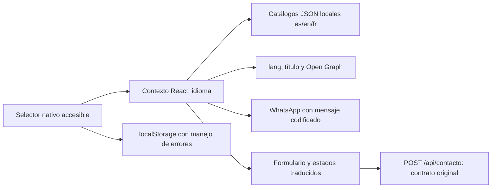

# CerTech — Mejoras web Fase 3: español, inglés y francés

**Dictamen: APROBADO LOCALMENTE para esta fase de frontend.**
Sin publicación, despliegue, commits, push, merge ni cambios en main. Sin servicios
nuevos, dependencias nuevas ni costos de infraestructura. La aprobación no se
extiende a producción ni a los pendientes de seguridad de fases anteriores.


## Alcance de esta rama en GitHub

Rama codex/i18n-es-en-fr, basada en el commit de WhatsApp 7c9cf981521d0a9aad056f814b844ab5ecd497b5. Incluye los archivos frontend tocados por i18n y este informe; conserva las comprobaciones estrictas de confirmación HTTP del servicio de contacto. No incorpora el backend de correo, migraciones, CI ni los archivos de configuración Vercel/CSP y seguridad que permanecen pendientes en la carpeta local.

Validación independiente antes de subir: **30/30 pruebas y build Vite 6.4.5 correcto** con instalación npm reproducible. Las 32 pruebas y comprobaciones CSP descritas abajo corresponden al entorno local completo: dos pruebas de configuración de seguridad aún no forman parte de esta rama. No interpretar esta rama como preparación completa ni aprobación de producción. Las capturas son artefactos locales, no archivos publicados.

## A. Auditoría e inventario de textos

Revisados App, datos de servicios/proyectos, ContactForm, ProjectCard, WhatsApp,
servicio HTTP, entrada React, HTML, estilos, pruebas y configuración CSP.

Catálogos independientes: `frontend/src/i18n/locales/es.json`, `en.json`, `fr.json`.
**205 claves semánticas idénticas por idioma (615 cadenas).** Inventario completo:
los propios catálogos; sus grupos cubren:

| Grupo | Contenido |
|---|---|
| language / nav / brand | Selector, anuncios, menú, apertura/cierre, inicio accesible |
| meta | Título, descripción y Open Graph |
| actions / hero | CTA, titular, descripción, notas e ilustración tecnológica |
| services | Siete servicios, descripciones y beneficios |
| automation / workflow | Automatización y diagrama de flujo |
| about / why / method | Empresa, cuatro pasos, cuatro motivos y metodología |
| projects / art | Tres proyectos, características, enlaces, ilustraciones y alternativas |
| cta / contact | Invitación, introducción, ayudas y solicitud de cotización |
| form | Etiquetas, opcionales, placeholders, presupuestos, consentimiento, estados y validaciones |
| footer / privacy | Navegación, derechos, textos legales existentes e información de privacidad |
| whatsapp | Etiqueta accesible y mensaje predefinido en cada idioma |

Marcas CerTech, CERTECH SYSTEMS, MORA, Infinity Apparel, Shopify, n8n, números,
URLs y COP se conservan. Se localizan textos editoriales de las ilustraciones,
incluido «Opening soon», sin atribuir nuevas funciones a los proyectos.
«Shopify Development» permanece como valor del contrato; su etiqueta española
se presenta como «Desarrollo Shopify».

## B. Archivos implementados

Existentes modificados, exclusivamente frontend:

1. `frontend/index.html` — Open Graph locale inicial en español.
2. `frontend/src/main.jsx` — proveedor y CSS de i18n.
3. `frontend/src/App.jsx` — traducciones, selector y claves estables.
4. `frontend/src/components/ContactForm.jsx` — etiquetas y validación localizada.
5. `frontend/src/components/ProjectCard.jsx` — contenido público y accesibilidad.
6. `frontend/src/components/WhatsAppButton.jsx` — mensaje/etiqueta por idioma.
7. `frontend/src/data/site.js` — metadatos estables, valores API y claves de catálogo.
8. `frontend/src/services/contactService.js` — códigos locales para errores HTTP.
9. `frontend/src/services/contactService.test.js` — cuatro regresiones HTTP añadidas.

Nuevos:

- `frontend/src/components/LanguageSelector.jsx`
- `frontend/src/i18n/I18nProvider.jsx`
- `frontend/src/i18n/core.js`
- `frontend/src/i18n/contactFeedback.js`
- `frontend/src/i18n/i18n.test.js`
- `frontend/src/i18n/locales/es.json`
- `frontend/src/i18n/locales/en.json`
- `frontend/src/i18n/locales/fr.json`
- `frontend/src/styles/i18n.css`
- `frontend/security/i18n-source.test.mjs`
- `docs/web-phase-3-i18n.md`
- `docs/web-phase-3-i18n-evidence.json`

21 archivos de esta fase: 9 existentes y 12 nuevos. Capturas fuera del repositorio,
en la carpeta local de artefactos indicada en la evidencia, sin añadir binarios a Git.

## C. Arquitectura y contratos



- Implementación ligera mediante Context de React; tres idiomas y una SPA de
  contenido estático no requieren un motor i18n adicional. Catálogos empaquetados
  localmente: ninguna API de traducción ni petición de catálogos al cambiar idioma.
- Español inicial sin preferencia. Solo `es`, `en`, `fr` son valores admitidos;
  preferencia en `localStorage['certech.language']`. Lectura/escritura bloqueadas
  o inexistentes no provocan errores: el idioma funciona en memoria.
- Selector nativo siempre visible en el encabezado sticky, incluso con menú
  móvil cerrado; nombres Español / English / Français y etiqueta localizada.
  Conserva foco visible y soporte de teclado nativo; no depende de banderas.
- Estado y claves estables conservan formulario, consentimiento y valores elegidos.
  Cambiar idioma no navega ni recarga. Antes de cambiar se registra la sección
  visible; después del reflujo se restaura su posición relativa sin animación.
  El scroll global puede variar si cambia la altura del texto anterior: se
  conserva el punto de lectura de la sección, en lugar de saltar a otro contenido.
- `document.documentElement.lang`, título, descripción, OG title/description/locale
  se actualizan antes de pintar. OG usa es_CO, en_US y fr_FR como convenciones
  lingüísticas; no se detecta la ubicación del visitante.
- Los fragmentos `#inicio`, `#servicios`, `#nosotros`, `#proyectos`, `#contacto` y
  demás IDs permanecen iguales. No se añade router ni rutas por idioma.

### Formulario

Nombres de payload sin cambios: `nombre`, `correo`, `empresa`, `servicio`,
`presupuesto`, `descripcion`, `aceptaPrivacidad` (booleano).

Siete valores de servicio y cinco opciones de presupuesto conservan exactamente
su texto/valor original para Spring Boot. Solo las etiquetas se traducen; los
presupuestos siguen expresados en COP, sin conversiones monetarias.

Se conservan required, email, longitudes y consentimiento. Se usan mensajes
inline localizados, aria-invalid, aria-describedby, foco en el primer campo
incorrecto y región viva. `noValidate` suprime únicamente las burbujas del navegador,
que no siguen necesariamente el idioma elegido; la validación se ejecuta antes
del fetch. El backend sigue siendo la autoridad de validación.

La capa HTTP mantiene la comprobación estricta de 201, ID entero positivo,
servicio y fecha válidos. Los códigos `network`, `validation`, `tooLarge`,
`rateLimit`, `submit`, `unconfirmed` permiten localizar errores sin mostrar
mensajes españoles del servidor en inglés/francés. Los campos de error se
filtran mediante lista conocida. El Error conserva mensajes diagnósticos para
compatibilidad, pero la UI nunca los renderiza directamente. No se añade idioma
al JSON, headers, URL o tabla. Solo un 201 confirmado limpia el formulario.

El mensaje de éxito confirma **registro**, nunca entrega de correo.
Spring Boot, PostgreSQL, la outbox y las notificaciones de correo permanecen
sin modificación y no fueron iniciados en esta fase.

### Seguridad y diseño

- Sin dangerouslySetInnerHTML ni HTML en los catálogos; React renderiza texto.
- Sin inline scripts/styles, eval, nuevos dominios o cambios en CSP/Vercel.
- Se mantienen HTTPS/URL de API, rel noopener noreferrer y target de WhatsApp.
- Se preservan los estilos originales; CSS adicional adapta textos largos,
  navegación/tablet, tarjetas y campos. No se añade animación; permanece vigente
  prefers-reduced-motion.

## D. Evidencia visual

Capturas locales en:
`/Users/pedroveras/.codex/visualizations/2026/10/22/01a16134-b61f-7a31-ad4e-d923594b23ad/certech-i18n-phase3/`

- Español: `es-desktop.png`, `es-mobile.png`.
- Inglés: `en-desktop.png`, `en-mobile.png`.
- Francés: `fr-desktop.png`, `fr-mobile.png`, `fr-320.png`,
  `fr-contact-320.png`, `fr-tablet.png`, `fr-mora-320.png`.

Vista previa aislada: **http://127.0.0.1:4183/**.
Formulario simulado: no hay persistencia, backend ni correo real en esta vista.
La carpeta fuente de pruebas es `/private/tmp/certech-i18n-phase3/work/`.

## E. Pruebas ejecutadas

**32/32 automatizadas, 0 omitidas**, incluidas las 11 anteriores.

| Comprobación | Evidencia |
|---|---|
| Catálogos completos | Mismas 205 claves, cadenas no vacías, variables de interpolación iguales, sin HTML |
| Contenido público | Auditoría AST de JSX: sin texto/etiquetas hardcoded salvo marcas |
| Preferencia | Casos es/en/fr, predeterminado es, valores no admitidos y storage bloqueado/ausente |
| Contrato | Valores API exactos; método/JSON/confirmación existentes; códigos 400/413/429/503 |
| WhatsApp | Número 573143608576, HTTPS, mensaje exacto por idioma y codificación |
| Validación | Obligatoriedad, email, longitudes y consentimiento; códigos/campos desconocidos filtrados |
| Build | Vite 6.4.5 correcto; ningún paquete añadido o actualizado |
| Guards de build | Missing/HTTP/API no autorizada rechazadas; HTTPS exacto permitido; canarios excluidos |
| Dist | 4 artefactos sin firmas de secretos/canarios ni sourcemaps |
| HTTP local | Cabeceras, recursos y 404 protegidos; fixtures 201/400/503 correctos |

Comprobaciones del navegador integrado sobre el **build de producción con CSP**:

- Idioma inicial español; paso a inglés/francés sin recarga; título/lang y WhatsApp
  correctos. Recarga explícita recupera francés de la preferencia guardada.
- Formulario con los siete valores conserva todos ellos al cambiar fr → en;
  variación observada del inicio de la sección: **−0,2421875 px**.
- Éxito simulado: mensajes correctos en en/fr/es, con actualización del estado
  visible al cambiar idioma. Validación 400 en es/fr y fallo 503 localizado en fr.
- Error cliente en francés: mensaje, aria-invalid y foco correcto. Los valores
  introducidos se conservan tras un error; solo el éxito confirmado los limpia.
- Selector nativo por teclado (búsqueda por letra y Enter), foco visible;
  apertura/cierre del menú móvil y consentimiento mediante teclado.
- Viewports: 1280×720, 390×844, 320×640, 768×1024. Sin overflow horizontal.
  Formulario a 320 px: extremo derecho de controles 232 px; WhatsApp empieza en
  248 px. Ilustración MORA contenida en tarjeta tras corregir el recorte.
- Aplicación sin errores/advertencias capturados en consola. Probe negativo de
  CSP conservó el título `CSP probe`: el script inline no cambió el documento.
- Semgrep OSS core 1.99.0: 37 archivos, 6 reglas locales, 0 hallazgos/errores.
- Gitleaks local y preservación final: resultados en la evidencia JSON adjunta.

### Límites del flujo verificado

| Frontera | Resultado |
|---|---|
| Selector → UI / metadatos | Verificado en navegador |
| UI → POST /api/contacto | Verificado por pruebas HTTP unitarias y fixture local |
| API → PostgreSQL / outbox / correo | No ejecutado en esta fase; archivos preservados |
| Respuesta → estado traducido | Verificado con confirmación/fallos sintéticos |

No se afirma que la prueba simulada haya guardado datos ni entregado correos.
No se realizaron solicitudes de prueba contra servidores públicos.

### Reproducción local

Con Node 24 y npm 11.6.2, dentro de una copia aislada:

```sh
cd frontend
npm ci --no-audit --no-fund
npm test
npm run build
node scripts/verify-dist.mjs
# Solo en la copia aislada: modifica/restaura temporalmente vercel.json.
node security/build.integration.mjs
# Puerto predeterminado para reutilizar security/http.integration.mjs:
node scripts/preview-security.mjs --test-fixtures
# En otro terminal, en frontend:
node security/http.integration.mjs
```

Para usar la vista de esta ejecución: `LOCAL_SECURITY_PORT=4183` al iniciar el
harness. La suite HTTP se ejecutó desde una copia temporal que solo cambia el
puerto de su URL loopback; el script de seguridad original permanece intacto.

Secuencia manual: elegir cada idioma, navegar por secciones, completar campos,
cambiar idioma, comprobar valores, enviar datos sintéticos y probar las
descripciones `simulated-validation` / `simulated-failure`. Comprobar también
recarga de preferencia y menú/selector con teclado. No usar datos reales.

## F. Problemas resueltos y pendientes

Resueltos:
- Textos literales y valores de API estaban mezclados: ahora se separan etiquetas
  traducidas de identificadores estables.
- Las validaciones nativas dependen del idioma del navegador: mensajes inline
  propios, sin relajar las restricciones ni las comprobaciones de confirmación.
- El encabezado y los campos quedaban estrechos en tablet: distribución adaptada.
- La relación de aspecto y altura mínima de las ilustraciones transferían un
  ancho mínimo que recortaba MORA a 320 px. Se fija su ancho al de la tarjeta y
  se adapta la cuadrícula interna; evidencia final de contención disponible.
- La normalización de apóstrofos en URLs difiere entre cadena generada y objeto
  URL: las pruebas verifican tanto construcción como mensaje decodificado.

Pendientes / límites:
- SPA sin URLs/SSR por idioma: metadatos cambian en el cliente; rastreadores que
  no ejecutan JS pueden ver el español estático. No se inventan hreflang o
  dominios. SEO multilingüe con URLs propias requeriría una fase distinta.
- Nuevos textos o errores backend requieren claves/mapeos adicionales. Las
  pruebas bloquean claves faltantes y texto JSX literal, pero una revisión
  editorial sigue siendo útil para futuras incorporaciones.
- Se verificó el navegador integrado con tamaños simulados; no una matriz de
  dispositivos físicos o lectores de pantalla. El storage bloqueado se probó
  de forma automatizada mediante inyección de fallos, no cambiando permisos reales.
- La traducción del texto legal conserva su sentido; no constituye una nueva
  aprobación de privacidad ni resuelve pendientes legales de fases anteriores.
- Los pendientes anteriores de hosting, seguridad y activación de correo siguen
  vigentes. No se aprueba producción.

## G. Preservación y dictamen

Se registraron hashes de los 100 archivos previos y se trabajó en copia aislada.
Transferencia final limitada a los 21 archivos enumerados, con comprobación de
conflictos antes de escribir. Backend, base de datos, correo, secretos, lockfile,
configuración Vercel/CSP y scripts de seguridad previos se conservan.

**APROBADO LOCALMENTE. Esperar autorización expresa antes de integrar o publicar.**
