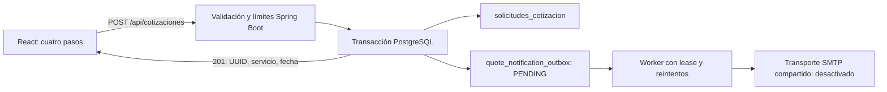

# CerTech — Mejora 6: cotizador de servicios

Fecha: 22 de octubre de 2026, America/Bogota. Dictamen: **APROBADO CON OBSERVACIONES para revisión local**. No constituye aprobación de producción ni autorización de integración.

## 1. Diagnóstico inicial y preservación

El repositorio original sigue en `security/phase-1-hardening`, con las fases locales de seguridad, contacto, correo e internacionalización sin integrar. Su inventario inicial de 112 archivos se conservó mediante SHA-256 y se verificó al cerrar la implementación. No se cambió de rama ni se realizó commit, push, merge o despliegue.

Las copias antiguas de `/private/tmp` habían desaparecido. Se recuperaron en lectura fundador y firma desde `codex/founder-morel-tech` (commit 79386c5d18a18d5e0fa40dabdc2b21f36643e08d). Se incorporaron a esta copia junto con el backend local completo, sin asumir que estuvieran en main. Los informes de fases anteriores se conservan como registros históricos; sus rutas temporales ya no representan la ubicación actual.

Ubicación persistente de la copia: `certech-phase6/work`, dentro de los artefactos locales de este chat. No es un checkout Git ni modifica el repositorio original.

Arquitectura encontrada: React 18/Vite, catálogos ES/EN/FR, siete servicios en `frontend/src/data/site.js`, formulario `POST /api/contacto`, Spring Boot 3.4.5/Java 21, PostgreSQL y Flyway V1–V3. El contacto ya registra transaccionalmente una fila y una notificación persistente, con reintentos y leases. SMTP está desactivado por defecto.

## 2. Funcionalidad implementada

Sección «Solicita tu cotización», antes del contacto general. Los CTA de cotización de cabecera y banda comercial apuntan a `#cotizacion`. El contacto conserva su endpoint y comportamiento.

1. Servicio: siete tarjetas obtenidas del catálogo existente, sin servicios ni tarifas nuevas.
2. Proyecto: título, descripción, objetivo, requisitos, plazo y presupuesto opcional reutilizando los rangos existentes. Los códigos internos no cambian de idioma.
3. Contacto: nombre, correo, empresa opcional, teléfono/WhatsApp opcional, país opcional y consentimiento explícito.
4. Revisión: resumen localizado, contenido del visitante sin traducir, regreso a pasos anteriores y envío.

La información se conserva al navegar y cambiar idioma. Permanece únicamente en memoria del navegador; no se guarda PII en localStorage y se pierde al recargar o cerrar la página. Indicador de progreso, foco por etapa, errores asociados a campos, controles por teclado, movimiento reducido, estados de carga/error/éxito y distribución desde 320 px. El éxito aparece solo ante HTTP 201 con UUID, servicio coincidente y fecha válida; no afirma entrega de correo. El foco se lleva a la confirmación tras registrar.

No se calcula ningún precio. El presupuesto es orientativo y CerTech deberá elaborar posteriormente la propuesta económica.

## 3. Backend, persistencia y contrato



DTO propio y tabla propia, sin reutilizar el campo descripción del contacto como contenedor de datos de cotización. Acceso JDBC parametrizado y transacción Spring. Se validan longitudes, campos obligatorios, correo, formato de teléfono, catálogo, plazo, presupuesto, UUID de solicitud y consentimiento. Se normalizan espacios antes de validar. El UUID interno y las fechas de recepción/consentimiento se generan en servidor/base de datos.

`requestId` es un UUID generado por el cliente para idempotencia; se almacena como clave única junto a la huella del payload. Los reintentos idénticos recuperan el mismo registro y no crean otra notificación. Si se reutiliza la clave con datos distintos, se responde 409 genérico. La escritura concurrente se resuelve mediante la restricción única y `ON CONFLICT`, dentro de la transacción. Si falla insertar la outbox, se revierte la cotización.

Respuesta: HTTP 201 con `{id, servicio, fechaCreacion}`; 400 para validación/JSON incorrecto, 409 para conflicto de referencia, 413 para exceso de cuerpo, 429 para límite de solicitudes, y error genérico para fallos internos. No se devuelven detalles personales, SQL ni excepciones.

Se amplió el interceptor de abuso existente a `/api/cotizaciones`, compartiendo su límite por proceso con contacto. Continúan los 16 KiB del cuerpo, CORS de orígenes exactos, cabeceras API y rechazo de cabeceras reenviadas como identidad confiable.

## 4. Migración y notificación

Única migración nueva: `backend/src/main/resources/db/migration/V4__quote_requests_and_outbox.sql`. Crea `solicitudes_cotizacion`, `quote_notification_outbox`, claves únicas, relación con borrado en cascada e índice de pendientes. V1–V3 se conservaron intactas. Se ejecutó Flyway únicamente en PostgreSQL sintético local: cuatro migraciones correctas, última V4.

La outbox de cotizaciones es independiente, para conservar la relación y el payload propios. Reutiliza configuración y transporte SMTP endurecido; aplica el mismo patrón existente de claim con `FOR UPDATE SKIP LOCKED`, token de lease, recuperación tras reinicio, reintentos exponenciales acotados, estado FAILED y Message-ID estable por notificación. Un worker antiguo no puede confirmar el lease de otro.

Asunto: «Nueva solicitud de cotización — CerTech». Incluye referencia, proyecto, descripción, objetivo, requisitos, servicio, plazo, presupuesto orientativo, contacto y fecha con zona America/Bogota. Plantilla HTML profesional y alternativa de texto plano; los campos del visitante se escapan. From se configura en backend y Reply-To se limita a una dirección válida.

`CONTACT_NOTIFICATIONS_ENABLED=false` durante la vista local. El destinatario inicial se conserva en la configuración backend existente: prodbydsceron@gmail.com. No hay credenciales nuevas ni variables VITE sensibles. Los logs del worker contienen identificador e intento, sin payload ni excepciones SMTP completas.

La garantía es registro transaccional y entrega al menos una vez cuando se habilite SMTP. No puede garantizarse exactamente una entrega: si el proveedor acepta un mensaje y falla el acknowledgement de base de datos, podría repetirse. Message-ID estable ayuda, pero el proveedor no está obligado a deduplicar.

## 5. Pruebas ejecutadas

| Verificación | Resultado |
|---|---|
| npm ci con lockfile existente, copia aislada | Correcta; sin cambios de versiones |
| Frontend: npm test | **35 aprobadas, 0 fallos** |
| Frontend: npm run build | Correcto, Vite 6.4.5 |
| Verificación de dist | 6 artefactos; sin sourcemaps ni patrones de secretos revisados |
| Backend Maven/Java 21 con PostgreSQL sintético | **59 aprobadas, 0 fallos, 0 omitidas** |
| Flyway PostgreSQL | V1–V4 correctas |
| SMTP TCP simulado | Aceptación y rechazo temporal en 127.0.0.1; MIME multipart/alternative correcto |
| Navegador → API → PostgreSQL | Tres cotizaciones sintéticas, tres notificaciones pendientes, cero intentos SMTP |
| Contacto existente desde navegador | Un registro sintético y su notificación pendiente |
| Responsive | 320, 390, 768 y 1280 px; sin desbordamiento horizontal observado |

Los tests backend incluyen datos válidos, campos ausentes, JSON malformado, límites de todos los campos principales, valores fuera de catálogo, correo y teléfono incorrectos, falta de consentimiento, persistencia, rollback, idempotencia, conflicto, concurrencia, leases, reintentos agotados, HTML escapado, origen CORS permitido/no permitido, tamaño de cuerpo, 429 y cabeceras X-Forwarded-For sin capacidad de eludir el límite. Los tests previos de contacto/correo también se ejecutaron.

Navegador: selección y avance por teclado, consentimiento con Space, validación sin servicio y sin consentimiento, ida/vuelta entre pasos, cambio ES→EN→FR conservando datos, resumen, API temporalmente detenida con error y datos retenidos, reintento correcto. Se pausó brevemente la API sintética para observar «Recording…» y ambos botones deshabilitados; se reanudó y se confirmó el registro. Se comprobó la confirmación en tres idiomas. Capturas en `../evidence/`.

La vista sirve el build con la CSP existente, sin unsafe-inline/unsafe-eval, con frame-ancestors none y nosniff. Se comprobaron por HTTP esas cabeceras y 404 para archivos de entorno/fuentes. Consola sin errores inesperados en la versión final. Son controles observados localmente; no acreditan ningún control en hosting público.

## 6. Entorno y reproducción

Vista: **http://127.0.0.1:4186/**, botón «Solicitar cotización». API sintética: 127.0.0.1:18086. PostgreSQL sintético: 127.0.0.1:55436, base `certech_mail_ci`. El proxy local solo reenvía POST/OPTIONS de los dos endpoints públicos al backend loopback. No hay fixtures que simulen éxito en esta vista.

En este entorno no había Java 21, PostgreSQL ni motor de contenedores. Se usaron Java 21 de Eclipse Adoptium y PostgreSQL 17.11 de la distribución oficial Postgres.app, montada en solo lectura. El clúster está fuera de las fuentes, en `/private/tmp/certech-phase6-runtime/pgdata`; solo escucha loopback, autentica conexiones TCP con SCRAM y no contiene datos reales. No se afirma aislamiento mediante contenedor. La clave aleatoria sintética está en un archivo 0600 fuera de la copia del proyecto; no se incluye aquí. El rol es de pruebas, no un diseño de mínimos privilegios de producción.

Para reproducir en un entorno preparado con Node 24/npm 11.6.2, Java 21 y PostgreSQL desechable:

```sh
npm --prefix frontend ci
# Establecer solo la URL y contraseña de una base sintética local llamada certech_mail_ci.
# CERTECH_SYNTHETIC_DB_ONLY=YES, MAIL_TEST_DB_URL y MAIL_TEST_DB_PASSWORD.
node tools/quote/local-checks.mjs
```

El script rechaza URLs que no sean JDBC loopback y la base sintética exacta. Ejecuta frontend, build, dist y Maven. `QUOTE_TEST_MAVEN_REPO` permite un repositorio Maven local y `QUOTE_TEST_OFFLINE=true` usa caché. Los tests de integración no deben apuntarse a una base compartida: limpian tablas y prueban rollback con restricciones temporales.

Para la vista: configurar backend con DB_URL/DB_USERNAME/DB_PASSWORD sintéticos, PORT=18086, SERVER_ADDRESS=127.0.0.1, CORS_ALLOWED_ORIGINS=http://127.0.0.1:4186 y CONTACT_NOTIFICATIONS_ENABLED=false; iniciar Spring Boot; compilar frontend y ejecutar `node tools/quote/preview.mjs` desde la raíz de esta copia. La instancia ya iniciada puede reutilizarse. No poner estos valores en VITE_* ni copiar la contraseña en comandos versionados.

Al terminar la revisión, detener los procesos de vista/API y el clúster de prueba con pg_ctl usando su directorio exclusivo; luego puede descartarse ese clúster sintético. Se mantienen activos ahora para permitir la revisión. No se instaló servicio permanente ni recurso facturable.

## 7. Riesgos y dependencias pendientes

- Aprobación visual y autorización independiente para integrar/publicar. Ninguna está implícita en este dictamen.
- El texto de consentimiento y el aviso de privacidad se prepararon para los nuevos campos en los tres idiomas. El propietario debe revisar su adecuación legal, política de conservación, supresión y tratamiento antes de producción. No se declara aprobación jurídica.
- SMTP real sigue desactivado. El remitente autorizado, proveedor, límites gratuitos y secretos backend deberán aprobarse/configurarse por separado. Las pendientes no se envían hasta habilitar y validar el sistema.
- El rate limit es por proceso y comparte cupo entre ambos formularios. No es protección distribuida ni sustituto de controles de hosting contra bots.
- Un reload crea un borrador nuevo; la idempotencia protege reintentos con la misma referencia, no deduplica solicitudes intencionales con claves diferentes. No se conserva PII en almacenamiento del navegador.
- La política de 16 KiB se aplica al JSON completo en bytes, incluso si todos los campos cumplen individualmente sus máximos; textos extensos con caracteres multibyte pueden recibir 413, con mensaje traducido.
- Cola y datos sintéticos permanecen en la base local para revisión. No hay mecanismo de borrado/retención automático nuevo ni panel de gestión.
- Los leases y Message-ID reducen duplicados, pero SMTP no ofrece exactamente una entrega garantizada.
- No se añadieron dependencias de aplicación. Las versiones heredadas no recibieron una auditoría externa de vulnerabilidades nueva en esta fase.
- Revisión de accesibilidad mediante semántica, foco, teclado y responsive; no sustituye una auditoría WCAG completa con lectores de pantalla.
- HTTPS, dominio final, CORS de producción, proxy confiable, backups, monitoreo y permisos mínimos del hosting siguen pendientes de implementación/verificación autorizada.

## 8. Archivos creados/modificados

El inventario siguiente compara esta copia con el repositorio original. Incluye archivos recuperados de las mejoras aprobadas 4/5 y los nuevos cambios de la fase 6; no indica modificaciones sobre el original.

- `backend/src/main/java/com/certech/config/WebConfig.java`
- `backend/src/main/java/com/certech/exception/ApiExceptionHandler.java`
- `backend/src/main/java/com/certech/notification/SmtpNotificationSender.java`
- `backend/src/main/java/com/certech/quote/QuoteController.java`
- `backend/src/main/java/com/certech/quote/QuoteEmailTemplate.java`
- `backend/src/main/java/com/certech/quote/QuoteNotification.java`
- `backend/src/main/java/com/certech/quote/QuoteNotificationOutbox.java`
- `backend/src/main/java/com/certech/quote/QuoteNotificationSender.java`
- `backend/src/main/java/com/certech/quote/QuoteNotificationWorker.java`
- `backend/src/main/java/com/certech/quote/QuoteRequest.java`
- `backend/src/main/java/com/certech/quote/QuoteResponse.java`
- `backend/src/main/java/com/certech/quote/QuoteService.java`
- `backend/src/main/java/com/certech/quote/QuoteSmtpSender.java`
- `backend/src/main/resources/db/migration/V4__quote_requests_and_outbox.sql`
- `backend/src/test/java/com/certech/quote/QuoteIntegrationTest.java`
- `backend/src/test/java/com/certech/quote/QuoteLimitsTest.java`
- `backend/src/test/java/com/certech/quote/QuoteSmtpTransportTest.java`
- `docs/web-founder-review.md`
- `docs/web-phase-5-signature.md`
- `frontend/src/App.jsx`
- `frontend/src/assets/alexander-ceron-480.webp`
- `frontend/src/assets/alexander-ceron-960.webp`
- `frontend/src/components/FounderSection.css`
- `frontend/src/components/FounderSection.jsx`
- `frontend/src/components/QuoteWizard.css`
- `frontend/src/components/QuoteWizard.jsx`
- `frontend/src/i18n/locales/en.json`
- `frontend/src/i18n/locales/es.json`
- `frontend/src/i18n/locales/fr.json`
- `frontend/src/quote/model.js`
- `frontend/src/quote/quote.test.js`
- `frontend/src/services/quoteService.js`
- `frontend/src/styles/i18n.css`
- `tools/quote/local-checks.mjs`
- `tools/quote/preview.mjs`

- `docs/web-phase-6-quotes.md` (este informe).

Evidencia complementaria: `../evidence/backend-results.json`, `frontend-tests.txt`, `database-aggregate.json`, `final-browser-database.json`, capturas ES/EN/FR y manifiesto de cambios. La revisión por patrones de secretos y del bundle no detectó credenciales; no equivale a una garantía universal.

## 9. Cierre técnico

El criterio funcional se cumplió en entorno local: selección de servicio real, datos de proyecto/contacto, registro transaccional en PostgreSQL y notificación persistente sin depender de SMTP. Portafolio, WhatsApp, contacto, idiomas, fundador, firma y controles anteriores permanecen en esta copia. Repositorio original intacto. Sin commits, push, merges, despliegues, infraestructura externa ni correos reales.

Se espera revisión visual y autorización expresa del propietario.
